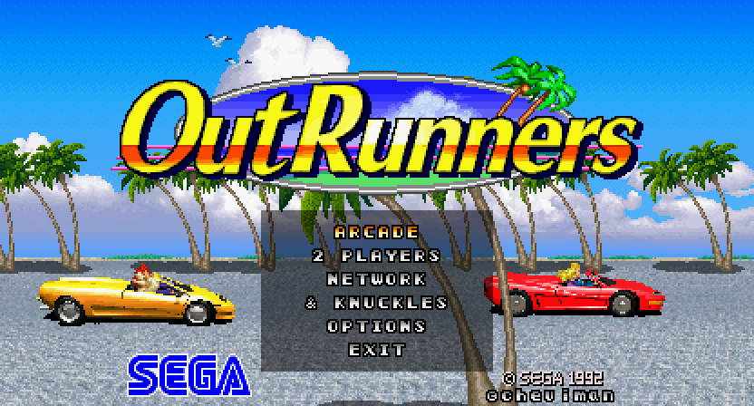
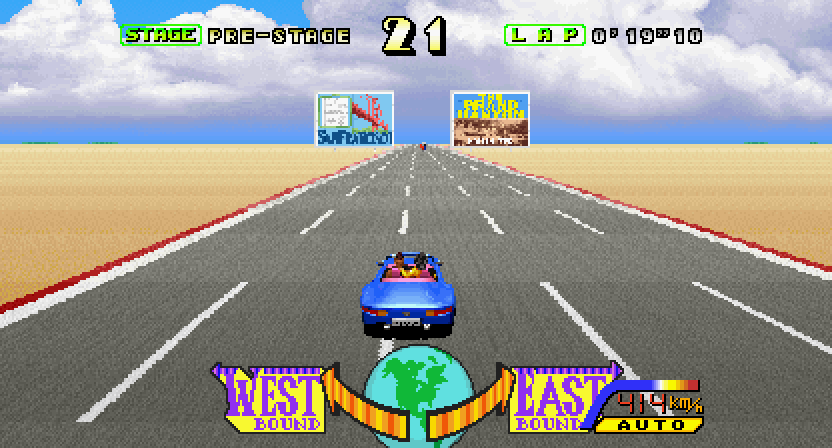
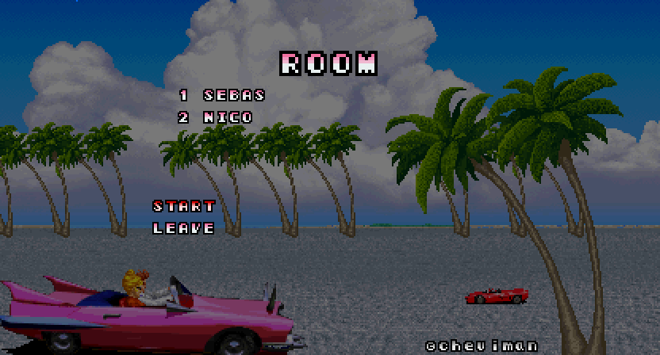
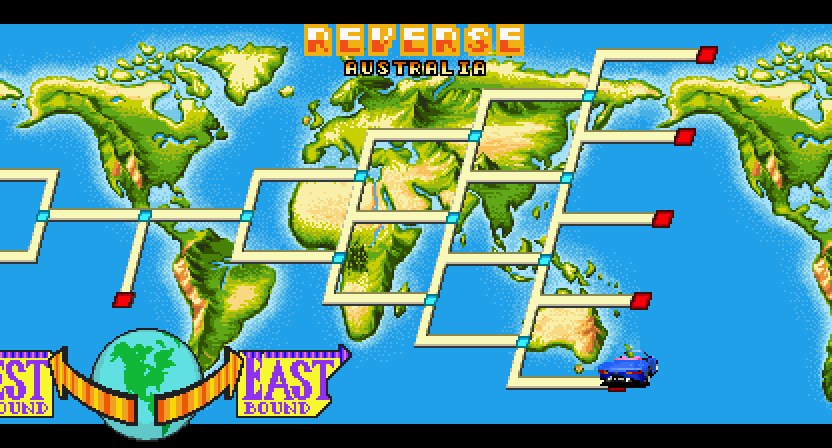
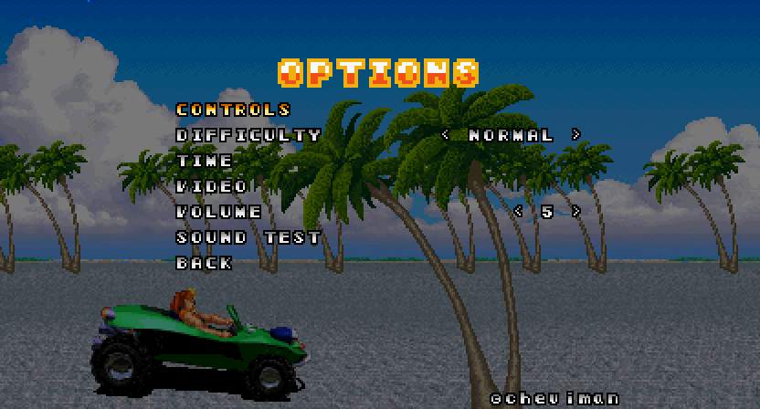
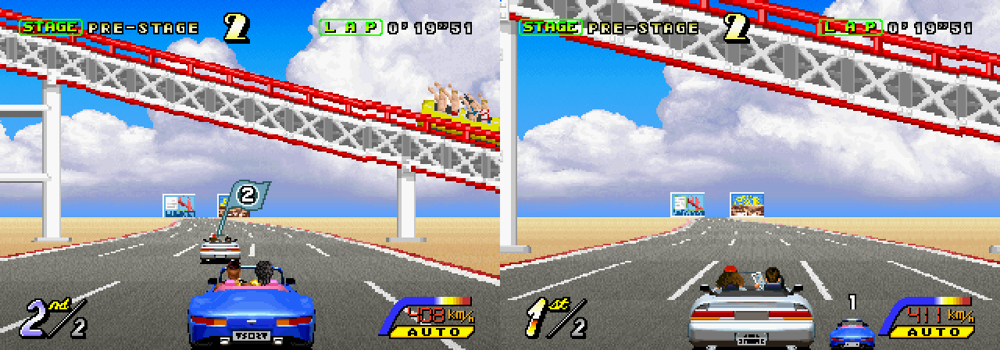

# OutRunners — port

Sega's 1992 arcade game *OutRunners* as a native game for computers, the Nintendo Switch, Android and Anbernic's
handhelds, built on its decompilation, [outrunners-decomp](https://github.com/cheviman/outrunners-decomp): the
game's program in C, checked frame by frame against MAME in picture and sound. Two games come out of it:

- **OutRunners Arcade**: the arcade game as it is, both cabinet screens side by side.
- **OutRunners**: the console version, the arcade game made for playing at home.

This repository contains no game data: you bring your own ROM set (MAME's `orunners`, World), and the game takes
its assets out of it.

<p align="center">
  
  
  
   REVERSE: the goal picked on the route map">
  
  <br>
  
</p>

## Playing it

Download the package for Windows, Linux or macOS from the
[releases](https://github.com/cheviman/outrunners-port/releases). Keep `orunners.zip` beside the game, or drop it
on its window when it asks: the first time, it takes the assets out of it.

Each device has a package of its own: the game without its assets, and the tool (for Windows, macOS and Linux)
that makes it on your computer with your ROM set:

- **Nintendo Switch** (`outrunners-switch.zip`): OutRunners NSP makes `OutRunners.nsp`, for a console with
  Atmosphere ([ports/switch](ports/switch/README.md)).
- **Android** (`outrunners-android.zip`): OutRunners APK makes `OutRunners.apk`
  ([ports/android](ports/android/README.md)).
- **Anbernic's H700 handhelds** (`outrunners-anbernic.zip`, RG35XX, RG40XX...): OutRunners Anbernic makes the
  folder for PORTS ([ports/anbernic](ports/anbernic/README.md)).

What a tool makes has the game's data in it: it is yours alone, never share it.

## The console version

- **ARCADE**: the arcade's game, one player.
- **2 PLAYERS**: both seats in one race, side by side or one over the other.
- **NETWORK**: up to four devices on the local network (below).
- **& KNUCKLES**: CLASSIC (the arcade's game, a little more time), TIME ATTACK (against your fastest run's ghost),
  FULL (all 31 courses in one race), REVERSE (from a goal back to the start).
- **OPTIONS**: controls, difficulty, time, video (window, full screen, sharp, smooth or CRT pixels, a wider
  picture: 16:10 for a Steam Deck, 16:9 or 20:9; VSYNC), volume, sound test, steering, FPS.
- **The pause** in a race: CONTINUE, RESTART, QUIT GAME.
- **The picture**: the scenery the arcade draws every other frame to make it look faint (the spray of Niagara's
  falls, the pyramids) is drawn see-through instead, so it does not blink.

## Controls

- **Keyboard**: the arrows steer, accelerate and brake; Q and A shift up and down; space is the radio; Enter
  starts and pauses.
- **Game controller**: the left stick or the d-pad steers, the right trigger accelerates, the left trigger
  brakes, the shoulders shift. OPTIONS > CONTROLS changes them.
- **Racing wheel**: a wheel SDL knows (a Logitech G29) works as it is plugged in. Any other (a Thrustmaster
  T300RS) is set up once in OPTIONS > STEERING > SET UP WHEEL: turn the wheel left, press the gas, the brake, and
  the buttons it asks for; pedals and a shifter plugged in on their own are taken as they are pressed. Also in
  STEERING: WHEEL ROTATION (your wheel's range: 900 on a G29), CENTRING (the cabinet's spring, on a wheel with
  force feedback), VIBRATION (the cabinet's wheel shaking in a crash and off the road, or a controller's rumble)
  and INPUT TEST.
- **Android**: touch controls on the screen, or a controller. With the touch controls the phone itself vibrates
  in a crash and off the road, at VIBRATION's strength; STEERING > PHONE VIBRATION turns it off.

## NETWORK

Up to four devices race together on the same local network (a house's Wi-Fi, or a phone's hotspot), as the
arcade's linked cabinets: computers, phones and the Switch alike.

1. NETWORK > NAME: your name, as the rooms show it.
2. One device picks HOST.
3. The others pick JOIN, and the room.
4. The host's START starts a race of all of them; after it, back to the room.

A device that stops being heard holds the race a moment (WAIT); after 3 seconds the race goes on without it. If
the one gone was the host, the next device hosts on. A firewall that asks about the game should let it reach the
private network. The rooms and the race's datagrams are [arcade-lan](https://github.com/cheviman/arcade-lan)'s,
which the ports of other decompiled arcade games share.

## What comes next

- **4 PLAYERS on the Switch**: up to four players in one race on one console.
- **iOS and the New Nintendo 3DS**: their ports, by [yoshisuga](https://github.com/yoshisuga), in
  [pull request 14](https://github.com/cheviman/outrunners-port/pull/14).

## Supporting it

The game is free, and stays free. If you want to support the decompilations and the ports, there is
[Patreon](https://www.patreon.com/ChevimanPorts), where supporters also have a say in what comes next, and
[GitHub Sponsors](https://github.com/sponsors/cheviman): entirely optional, nothing is locked behind either. If
anyone asks you to pay for this game, it is not this project.

## Building it

Python 3.10 or newer, CMake 3.20 or newer, a C11 / C++17 compiler and SDL2 2.30 or newer (on Windows its
development package for Visual C++ unpacked in `build/downloads/sdl2/`; elsewhere the system's, `libsdl2-dev` on
Debian and Ubuntu; or `-DORUNNERS_STATIC_SDL2=ON` to build it from its source). Clone it with its submodules and
build it:

```bash
git clone --recursive https://github.com/cheviman/outrunners-port
```

```bash
cmake -S . -B build/cmake
```

```bash
cmake --build build/cmake --config Release
```

Both games land in `build/bin/`, and take their assets out of `orunners.zip` the first time (beside them, or in
`rom/`). The devices' builds are in `ports/switch/`, `ports/android/` and
`ports/anbernic/`, each with its README; `console/PLAN.md` holds the console version's plan and what is done. The
decompilation itself (its status, the tools, the assets' formats, the checks against MAME) is
[outrunners-decomp](https://github.com/cheviman/outrunners-decomp)'s README.

## Legal

- This project is licensed under the BSD 3-Clause License; see `LICENSE`.
- The board's runtime (`runtime/`) follows the behavior of MAME's System 32 and Multi 32 driver, its sound chips
  and ymfm's YM3438, BSD 3-Clause, whose terms are in `tools/core/system32/reference/mame/LICENSE` and
  `ymfm/LICENSE` beside it.
- NETWORK's rooms and datagrams are [arcade-lan](https://github.com/cheviman/arcade-lan) (`lan/`, a submodule),
  BSD 3-Clause, whose terms are in `lan/LICENSE`.
- The window port links SDL2 (zlib License); the packages carry it inside the executable, with its terms and the
  ones above in `licenses/`.
- OutRunners is a trademark of SEGA. This project is not affiliated with or endorsed by SEGA.
